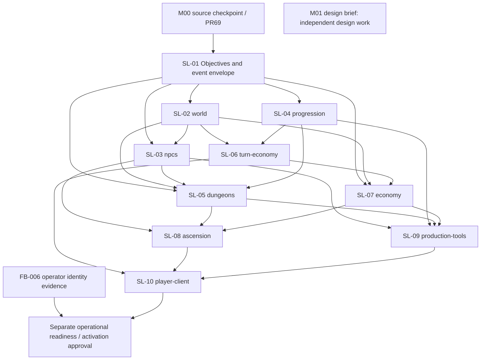

# M01 dependency board — v1.0.0

The [machine-readable issue tree](issue-tree.json) is a repository-local, ready-to-file backlog, **not a claim that GitHub issues were created**. All ten PR briefs are planned, with one primary feature domain and explicitly declared mutation owners. Estimates, staffing and delivery dates remain open. [The brief](vertical-slice-brief.md) defines the content and A-01–A-12 acceptance.

## External gates and integration discipline

M00-SOURCE: PR #69 is still open. Design work proceeds now; gameplay branches start from the reviewed integration candidate only after the main/merge relationship is reconciled and combined checks rerun if main changes. Do not treat a stacked PR as already integrated. M00-OPERATIONS: FB-006 remains open; it blocks readiness/activation claims, not isolated design or disposable testing. M01 is documentation only and preserves the M00 tested tree.

Every PR records its exact base/head, supported schema/readers, pinned content, required flags, automated and manual evidence, reset rules and rollback/forward-fix. Prefer one reviewable slice per PR; split a brief into child PRs if its server/UI/editor contract exceeds a manageable diff. Never merge dependent PRs out of order or count their checks against a different combined tree. Soft links can inform design but never require speculative implementations.

## Ordered issue tree

| PR brief | Priority | Primary owner | Hard issue dependencies | Scope |
|---|---|---|---|---|
| SL-01 | P0 | quests | M00-SOURCE for execution | Objective outcomes, reward ownership and telemetry envelope |
| SL-02 | P0 | world | SL-01 | Small region graph, lawful travel and world consequences |
| SL-03 | P0 | npcs | SL-01, SL-02 | Authored dialogue, clues and fail-forward quest routes |
| SL-04 | P0 | progression | SL-01 | Three native class slices, minimal species setup and companion |
| SL-05 | P0 | dungeons | SL-01, SL-02, SL-03, SL-04 | Compact seeded dungeon, mechanism and two-route boss |
| SL-06 | P1 | turn-economy | SL-02, SL-04 | Food, banked Turns, rest and storage in the region loop |
| SL-07 | P1 | economy | SL-01, SL-02, SL-06 | Vendor, routine crafting and one repeatable sink/faucet |
| SL-08 | P0 | ascension | SL-03, SL-05, SL-07 | Campaign conclusion, first Ascension knowledge and second route |
| SL-09 | P1 | production-tools | SL-03, SL-04, SL-05, SL-07 | Typed authoring, broken-package rejection and content review |
| SL-10 | P1 | player-client | SL-06, SL-08, SL-09 | Onboarding, second-run playtest and measured slice acceptance |

M01 is not a child execution dependency of every design activity; it supplies the contract for these gameplay issues. The source gate applies to all ten even where only transitive edges are shown. No arrow grants activation authorization.

## Single-writer mutation registry

Names below are proposed semantic field groups. They do not assert that matching tables, modules or APIs already exist. An implementation must map them to concrete fields/lifetimes and existing owners before a migration. A PR can coordinate several owners, but it cannot write their state directly or change their lifetime implicitly.

| State or commitment | Sole owning feature domain |
|---|---|
| `quest.objectives_and_terminal_outcome` | quests |
| `quest.principal_reward_claim` | quests |
| `run.quest_journal` | quests |
| `run.gold_and_currency_ledger` | economy |
| `inventory.custody_quantity_binding` | items |
| `run.xp_build_proficiency` | progression |
| `run.food_booze_tolerance` | consumption |
| `action.check_roll_and_retry_receipt` | checks |
| `account.learned_fact_unlock` | content-knowledge |
| `run.known_fact_projection` | content-knowledge |
| `run.travel_location_and_local_world_consequence` | world |
| `encounter.initiative_damage_effects_command_journal` | combat |
| `run.npc_memory_relationship` | npcs |
| `run.species_heritage_appearance` | identity |
| `run.companion_recruitment_control` | companions |
| `action.recipe_input_output_receipt` | crafting |
| `run.campaign_completion_proof` | campaign |
| `run.lifecycle_and_ascension_transition` | ascension |
| `content.definition_revision_release_manifest` | production-tools |
| `telemetry.sanitized_event_projection` | telemetry |
| `account.turn_balance_daily_receipts` | turn-economy |
| `instance.room_graph_seed_checkpoint` | dungeons |
| `instance.puzzle_mechanism_state` | interactions |

Transaction contract: a quest coordinator requests checks/costs/proofs from their owning domains, then atomically records the terminal objective/claim and invokes the Gold/item/XP owners with the same principal identity. The quest reward claim is unique per declared objective/run or repeatable epoch; it is not a generic permission to mint. No client, NPC prose, combat adapter or analytics consumer writes another domain’s state. Declare lock order, active-run/revision checks, reservation policy and outbox behavior before implementing multi-owner settlement. Technical rollback is distinct from a paid authored failure.

Lifecycle contract: account knowledge/daily entitlement persists as declared; run build/quests/local consequences and current recruitment reset/archive under their owners; instance graph/checkpoint and encounter journals obey pinned lifetimes; shared/live state does not reset on personal Ascension. A new field requires a field-manifest entry and rollover/Ascension tests. The telemetry owner writes a sanitized projection only, never reward/economy truth.

## Milestones and stop rules

| Milestone | Required PR briefs | Exit evidence |
|---|---|---|
| S1 — A choice changes the world | SL-01, SL-02, SL-03, SL-04 | Playable two-approach objective, native class difference and disconnect-safe state. |
| S2 — A complete first life | SL-05, SL-06, SL-07 | Local crisis concluded, economy/daily loop and recovery are understandable. |
| S3 — A better second life | SL-08, SL-09, SL-10 | Knowledge changes route, designer authors content, measured acceptance passes; operations remain separate. |

Do not deepen combat, multiply catalogs or add independent social/live systems while S1 cannot complete an ordinary objective with two approaches. S2 must conclude the local crisis with a recoverable economy/daily loop. S3 must change decisions in life two, prove typed authoring and pass measured acceptance. Launch-scale endgame, roster and operations still require later milestones.

## PR-ready acceptance contracts

### SL-01 — Objective outcomes, reward ownership and telemetry envelope

- Primary domain: quests. Hard dependencies: M00-SOURCE for execution.
- Player/designer UI: Journal shows known objectives, next legal actions, costs, failure and retry explanation; event failure never causes reward retry.
- Integration risk: Do not create a generic reward faucet or copy combat XP into quest settlement.
- Acceptance: One fixture objective accepts combat and peaceful proof, awards principal XP/loot once through owning adapters, and preserves resolved outcome after restart.
- Acceptance: Concurrent approaches, stale revisions, retries and abandoned checks cannot double-claim or reroll.
- Acceptance: Emit versioned sanitized objective/check/reward events at commit, with no narrative text or secret mechanics.
- Canon: `06#graph` (SEC-89BB26A2D59A), `06#outcomes` (SEC-C7179DE03E81), `06#rewards` (SEC-3AABC279DD47), `23#transactions` (SEC-D40A81E9A7E9), `29#retry` (SEC-0EBDCFD3D064), `45#objective-xp` (SEC-B6310FD8853C), `46#s28-telemetry-philosophy` (SEC-DDF55CBA5A82).

### SL-02 — Small region graph, lawful travel and world consequences

- Primary domain: world. Hard dependencies: SL-01.
- Player/designer UI: Known map/list routes, cost confirmation, inaccessible-route reasons, return-to-town and resume.
- Integration risk: A map icon or generic scope table does not establish traversal; local run consequences must not mutate live-world state.
- Acceptance: Town, wilderness and dungeon entrance connect with explicit costs, discovered edges and route IDs.
- Acceptance: Travel duplicate/stale/reconnect, rollover and reserve guards compose with existing Turn owner; no real-time trek or field camp.
- Canon: `18#summary` (SEC-D0BE48150A2B), `33#summary` (SEC-EAB288316157), `23#scopes` (SEC-A8B95255B42B), `46#s11-vertical-slice-definition` (SEC-B087FC3D04A7).

### SL-03 — Authored dialogue, clues and fail-forward quest routes

- Primary domain: npcs. Hard dependencies: SL-01, SL-02.
- Player/designer UI: Dialogue choices and safe free-text field, Journal clue recap, explicit intent confirmation, degraded-mode fallback.
- Integration risk: NPC memory, account knowledge and quest truth use separate owners/scopes. No case-file/theory-graph subsystem.
- Acceptance: Q1–Q4 from the brief are reachable with combat and noncombat outcomes; missing NPC/clue never hard-locks the campaign.
- Acceptance: One NPC and one scene map free text to approved intents with preview/confirmation and deterministic authored fallback.
- Acceptance: Undiscovered dialogue choices, clue facts and alternate routes do not leak through queries, counts, logs or AI context.
- Canon: `34#authored_dialogue` (SEC-7A5328E82352), `34#conversation_pipeline` (SEC-B35D4CCC3427), `38#summary` (SEC-D9F5E3D6FC14), `06#evidence` (SEC-B4B2EAB5FCDF), `29#knowledge` (SEC-CDBF19BE7CE4), `16#parser` (SEC-D2997A73FD42).

### SL-04 — Three native class slices, minimal species setup and companion

- Primary domain: progression. Hard dependencies: SL-01.
- Player/designer UI: Creation comparisons, native-resource explanations, species trait/appearance preview, companion recruitment/control and safe build resume.
- Integration risk: Do not rename basic attacks into completed class engines, promote example subclasses or make class/species shortcuts mandatory.
- Acceptance: Fighter, Rogue and Wizard each show a distinct native decision loop and world affordance; authored fixture stats are not full launch engines.
- Acceptance: Human and goblin provisional slice records permit all three classes with bounded contextual traits; no separate culture or mechanical Background.
- Acceptance: One recruitable companion supports each solo class without a mandatory trinity; evaluate one Familiar path cost explicitly before final slice gate.
- Canon: `03#classes` (SEC-DA650EE8C6FE), `43#class-engine` (SEC-F530750275A6), `43#world-facing` (SEC-7C5B880E5F21), `43#subclass-deferred` (SEC-4A15AFE0BE63), `37#roster` (SEC-7C10DEA12E66), `37#species-class` (SEC-86C6F5FF8470), `09#summary` (SEC-236D9A81106B).

### SL-05 — Compact seeded dungeon, mechanism and two-route boss

- Primary domain: dungeons. Hard dependencies: SL-01, SL-02, SL-03, SL-04.
- Player/designer UI: Room map/list, known exits, puzzle choices, forecasted boss windup, recover/retreat and final outcome summary.
- Integration risk: Combat victory is evidence, not permission to write quest/XP/Gold directly; no world-boss or raid expansion.
- Acceptance: One authored five-landmark dungeon plus themed filler variation, meaningful checkpoint and persisted seed.
- Acceptance: Fight the Bellwarden or resolve its mandate through the discovered release ritual; either yields one campaign completion proof via owning domain.
- Acceptance: Boss has two readable mechanics with counterplay, retreat/re-entry and exact restore/reconnect; puzzle failure opens a costed salvage route.
- Canon: `32#topology` (SEC-E4894EBAB607), `32#filler` (SEC-68B51C729A60), `32#seed` (SEC-AC066BBA2836), `32#puzzle_validation` (SEC-C323A74D58DA), `42#status` (SEC-4DAC37BE9068), `44#ending` (SEC-3DF6D9A8B462).

### SL-06 — Food, banked Turns, rest and storage in the region loop

- Primary domain: turn-economy. Hard dependencies: SL-02, SL-04.
- Player/designer UI: Food/booze planner, costs/yields, banked Turn state, rest confirmation and personal storage entry from town.
- Integration risk: Fixture integration does not activate production rollover policy or introduce a new settlement path.
- Acceptance: Three small reviewed consumables and one rest/service use existing Turn/consumption rules; expose nightcap, reserve and recovery limitations.
- Acceptance: Simulated rollover during/resuming encounters and Ascension cannot duplicate daily charges, reset undo eligibility or bypass capacity.
- Canon: `01#summary` (SEC-AAF5E8771CD3), `02#summary` (SEC-361F1E9F00FE), `19#summary` (SEC-428E4E8B3F9D), `46#s11-vertical-slice-definition` (SEC-B087FC3D04A7).

### SL-07 — Vendor, routine crafting and one repeatable sink/faucet

- Primary domain: economy. Hard dependencies: SL-01, SL-02, SL-06.
- Player/designer UI: Buy/sell only permitted items, price preview, storage/carry reasons, recipe inputs/outputs and repair receipt.
- Integration risk: Vendor coordinates existing owners; no player market, escrow or commissioning scope.
- Acceptance: One town vendor, one routine recipe and explicit reward/service budgets support meaningful equip/store choices.
- Acceptance: Repeatable salvage contract yields budgeted Gold; repair/provisioning consumes Gold/materials. Fixed proposal values live in versioned data, never class/client code.
- Acceptance: Retry/concurrency, overcapacity, locked/bound items and stale prices conserve currency/custody and cannot farm quest principal rewards.
- Canon: `11#summary` (SEC-4978701DE6A0), `08#summary` (SEC-DC35816EF894), `07#summary` (SEC-FD97C738124D), `28#summary` (SEC-49E93FC4B6EF), `45#economy-balance` (SEC-07DA039B7558).

### SL-08 — Campaign conclusion, first Ascension knowledge and second route

- Primary domain: ascension. Hard dependencies: SL-03, SL-05, SL-07.
- Player/designer UI: Real ending and stay-in-Aftercore choice; preserve/reset/archive review; knowledge entry and second-run route hint.
- Integration risk: Reuse discovery persistence; no invented numeric Mastery grant, class-engine inheritance, forced Ascension or lore explanation.
- Acceptance: Optional Aftercore → current preview → explicit confirm → new run retains Sluice Survey knowledge but resets local quests/NPC outcomes and class build.
- Acceptance: Life two uses the known culvert to reach the chamber by a different route; knowledge reveals possibility, not an automatically opened door.
- Acceptance: Repeated/stale/interrupted confirmation and rollover cannot duplicate discoveries, rewards or daily entitlement; old history remains readable.
- Canon: `10#eligibility` (SEC-F760BC55406E), `10#transition` (SEC-1646F347AAD9), `10#persistent` (SEC-9F849430663A), `10#worldstate` (SEC-E7A7D69BC4B1), `03#mastery` (SEC-49E9070156C1), `44#ascension` (SEC-3D46E28A6707), `46#s13-why-ascension-must-arrive-early` (SEC-756DC3D454F6).

### SL-09 — Typed authoring, broken-package rejection and content review

- Primary domain: production-tools. Hard dependencies: SL-03, SL-04, SL-05, SL-07.
- Player/designer UI: Designer UI with diagnostics linked to fields/nodes and preview of player-visible text.
- Integration risk: Current Studio is a foundation; mock JSON edits alone do not satisfy the no-code acceptance.
- Acceptance: Designer edits one monster, item, quest, encounter and loot table through Studio without editing source, validates, previews, compares and exports a candidate.
- Acceptance: Intentionally broken references, unreachable victory, reward duplication, missing failure route, hidden-data exposure and invalid budget fail before seal.
- Acceptance: Review records content IDs/revisions, principal budgets, secrets, lifetimes and dependencies; no live adoption in this work.
- Canon: `46#s16-design-admin-client-core-editors` (SEC-A69101F627D6), `46#s23-automated-validation-catalog` (SEC-216DEF400F05), `46#s25-publishing-pipeline` (SEC-7276C4D524F5), `46#s44-definition-of-done-content` (SEC-C9073FBB868B).

### SL-10 — Onboarding, second-run playtest and measured slice acceptance

- Primary domain: player-client. Hard dependencies: SL-06, SL-08, SL-09.
- Player/designer UI: Keyboard/phone/reduced-motion/zoom-safe full loop with no external instructions; meaningful error and offline/reconnect recovery.
- Integration risk: Source CI is not usability, accessibility-device or live readiness evidence.
- Acceptance: Execute all A-01–A-12 scenarios in the brief with exact source/build/content/configuration evidence.
- Acceptance: Measure two runs per tester; record route/class changes, comprehension, fun/friction and severity defects separately from automated mechanics checks.
- Acceptance: Refresh the eight-axis status matrix, M00 identity gap and release checklist; no production activation implied.
- Canon: `16#access` (SEC-2886B151AD2D), `16#tutorials` (SEC-BA0B94DF0BBF), `45#telemetry` (SEC-A56C39368A81), `45#no-personal-scaling` (SEC-6472C3014E59), `46#s12-vertical-slice-success-criteria` (SEC-CE044A67A38F), `46#s60-accessibility-ux-gate` (SEC-1A89E2664689).
